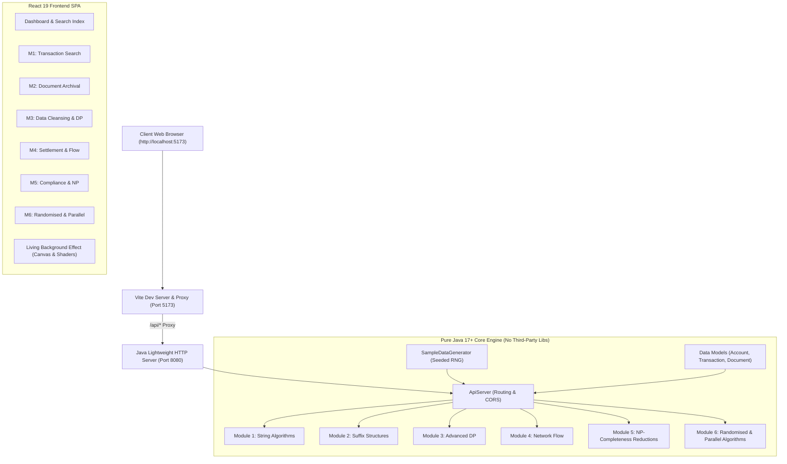

# FinServe - Intelligent Banking Analytics Platform
## Complete Technical Architecture & User Manual

---

## 1. System Overview & Architecture

**FinServe** is an institutional-grade banking analytics and algorithmic settlement platform designed to demonstrate advanced Data Structures and Algorithms (DSA) applied to realistic financial domain challenges.

### System Architecture Diagram



### Core Architecture Characteristics
- **Zero Third-Party Java Dependencies**: The backend runs exclusively on standard Java SE runtime (`com.sun.net.httpserver.HttpServer`), avoiding heavyweight frameworks (Spring, Quarkus) for ultra-fast compilation and instant startup.
- **Embedded Seeded Dataset**: Complete financial database seeded deterministically with realistic Indian and international banking topologies.
- **Micro-Interactions & Glassmorphism UI**: High-fidelity frontend built in React 19 and Vite with 60 FPS HTML5 Canvas particles and liquidity wave shaders.

---

## 2. Exhaustive File Catalog & Algorithm Inventory

Every file in the repository is cataloged below with its purpose, implemented algorithm, mathematical mechanics, and financial business use case.

### 2.1 Backend Entry Points & Core Infrastructure

#### [`src/com/finserve/Main.java`](file:///Users/meherbhoyar/Desktop/FinServe/src/com/finserve/Main.java)
- **Role**: Main server entry point.
- **Functionality**: Parses command-line port arguments (defaults to port `8080`), instantiates `ApiServer`, boots HTTP listeners, and attaches JVM shutdown hooks for graceful termination.
- **Algorithms**: Socket binding and JVM lifecycle hooks.

#### [`src/com/finserve/server/ApiServer.java`](file:///Users/meherbhoyar/Desktop/FinServe/src/com/finserve/server/ApiServer.java)
- **Role**: Built-in HTTP REST controller and request dispatcher.
- **Functionality**:
  - Initializes in-memory records (100 transactions, 20 accounts, 4 regulatory documents).
  - Registers 21 specialized REST endpoints (`/api/module1/*` through `/api/module5/*`).
  - Handles CORS preflight (`OPTIONS`), query string decoding, and JSON payload parsing.
- **Algorithms**: Linear dispatch table, HTTP state routing.

#### [`src/com/finserve/util/JsonUtil.java`](file:///Users/meherbhoyar/Desktop/FinServe/src/com/finserve/util/JsonUtil.java)
- **Role**: Custom reflection-free JSON serializer and parser.
- **Functionality**: Converts Java Maps, Lists, primitive arrays, and multidimensional arrays to valid JSON strings; parses flat JSON request payloads without external libraries (like Jackson or Gson).
- **Algorithms**: Recursive string builder serialization, recursive-descent string scanner.
- **Complexity**: Time $\mathcal{O}(L)$, Space $\mathcal{O}(L)$ where $L$ is token length.

---

### 2.2 Data Models (`src/com/finserve/model/`)

#### [`src/com/finserve/model/Account.java`](file:///Users/meherbhoyar/Desktop/FinServe/src/com/finserve/model/Account.java)
- **Role**: Core entity representing bank customer accounts.
- **Attributes**: `accountId`, `holderName`, `accountType` (`SAVINGS`, `CHECKING`, `BUSINESS`, `INVESTMENT`), `balance`, `branch`, `ifscCode`, and `transactionIds`.
- **Key Methods**: Custom `toJson()` stringifier with JSON character escaping.

#### [`src/com/finserve/model/Transaction.java`](file:///Users/meherbhoyar/Desktop/FinServe/src/com/finserve/model/Transaction.java)
- **Role**: Financial transaction ledger record.
- **Attributes**: `transactionId`, `senderAccount`, `receiverAccount`, `amount`, `description`, `paymentCode`, `transactionType` (`WIRE`, `ACH`, `SWIFT`, `INTERNAL`, `CARD`, `UPI`, `NEFT`, `RTGS`), `status` (`COMPLETED`, `PENDING`, `FLAGGED`, `REJECTED`), `timestamp`, and `currency`.
- **Key Methods**: ISO-8601 formatting, `toJson()`.

#### [`src/com/finserve/model/FinancialDocument.java`](file:///Users/meherbhoyar/Desktop/FinServe/src/com/finserve/model/FinancialDocument.java)
- **Role**: Unstructured financial report and regulatory disclosure document.
- **Attributes**: `documentId`, `title`, `content`, `documentType` (`REPORT`, `STATEMENT`, `AUDIT`, `COMPLIANCE`), `date`, and `author`.

---

### 2.3 Data Layer, Dataset Presets & Kaggle Compatibility

#### [`src/com/finserve/data/SampleDataGenerator.java`](file:///Users/meherbhoyar/Desktop/FinServe/src/com/finserve/data/SampleDataGenerator.java)
- **Role**: Realistic in-memory default banking dataset generator.
- **Functionality**:
  - Deterministic pseudo-random generation using `new Random(42)`.
  - Generates 100 transaction records, 20 high-net-worth accounts across major Indian financial hubs (Mumbai, Bangalore, Delhi, Chennai, etc.).
  - Generates 4 detailed corporate compliance filings and audit reports.
  - Maintains master watchlist of AML/CFT indicators (`"shell company"`, `"structuring"`, `"smurfing"`, `"round-tripping"`, etc.).
  - Concatenates transaction narratives into indexed search corpora.

#### [`src/com/finserve/data/DatasetPresets.java`](file:///Users/meherbhoyar/Desktop/FinServe/src/com/finserve/data/DatasetPresets.java)
- **Role**: Specialized banking dataset generators modeled after real Kaggle financial fraud and transaction datasets.
- **Presets Available**:
  - **AML Suspicious Activity Dataset**: 250 transactions with elevated fraud signals — shell corporation transfers, smurfing below regulatory thresholds, multi-layered international wires, and emergency cash overrides.
  - **Global SWIFT & Forex Dataset**: 200 high-value cross-border settlements across 12 global currencies (USD, EUR, GBP, JPY, CHF, SGD, AED, etc.) with correspondent banking chains.
  - **Retail High-Volume Dataset**: 500 consumer retail transactions across UPI, credit/debit card POS, EMIs, and e-commerce payments.

#### [`src/com/finserve/data/DatasetManager.java`](file:///Users/meherbhoyar/Desktop/FinServe/src/com/finserve/data/DatasetManager.java)
- **Role**: Central thread-safe dataset registry and dynamic data loader.
- **Functionality**:
  - Manages active in-memory ledger records, bank accounts, and compliance dossiers.
  - Dispatches active dataset instances to all 6 algorithm modules dynamically.
  - Parses uploaded CSV and JSON files with fuzzy column matching (compatible with Kaggle's *Bank Transaction Dataset for Fraud Detection*).
  - Automatically synthesizes bank accounts and regulatory audit reports when custom transaction CSVs are uploaded without account tables.

---

### 2.4 Module 1: Exact String Algorithms (`src/com/finserve/module1_string/`)

| File | Primary Algorithm | Time Complexity | Space Complexity | Financial Use Case |
| :--- | :--- | :--- | :--- | :--- |
| [`TransactionCodeSearch.java`](file:///Users/meherbhoyar/Desktop/FinServe/src/com/finserve/module1_string/TransactionCodeSearch.java) | **KMP (Knuth-Morris-Pratt)** | $\mathcal{O}(n + m)$ | $\mathcal{O}(m)$ | Searches for specific payment codes, transaction tokens, or swift references in ledger descriptions by building the Longest Proper Prefix which is also Suffix (`lps`) failure table to avoid backtracking. |
| [`PatternAnalyzer.java`](file:///Users/meherbhoyar/Desktop/FinServe/src/com/finserve/module1_string/PatternAnalyzer.java) | **Z-Function (Z-Algorithm)** | $\mathcal{O}(n + m)$ | $\mathcal{O}(n + m)$ | Computes Z-array where $Z[i]$ is the length of the longest substring starting at $S[i]$ matching the prefix of $S$. Surfaces automated recurring transactions, standing orders, and repetitive billing scripts. |
| [`FinancialCodeLookup.java`](file:///Users/meherbhoyar/Desktop/FinServe/src/com/finserve/module1_string/FinancialCodeLookup.java) | **Rabin-Karp Rolling Hash** | $\mathcal{O}(n + m)$ avg, $\mathcal{O}(nm)$ worst | $\mathcal{O}(1)$ auxiliary | Uses polynomial rolling hash (base 256, prime $10^9+7$) to verify SWIFT codes, IFSC codes, and routing codes across thousands of records with minimal character-by-character checks. |
| [`FraudPatternDetector.java`](file:///Users/meherbhoyar/Desktop/FinServe/src/com/finserve/module1_string/FraudPatternDetector.java) | **Aho-Corasick Multi-Pattern Automaton** | $\mathcal{O}(n + m + z)$ | $\mathcal{O}(m \cdot \Sigma)$ | Multi-pattern string matching. Builds a trie of all AML indicator keywords with BFS-computed failure links and output dictionaries. Simultaneously scans text for dozens of fraud phrases in a single linear pass. |

---

### 2.5 Module 2: Suffix Structures & Indexing (`src/com/finserve/module2_suffix/`)

| File | Primary Algorithm | Time Complexity | Space Complexity | Financial Use Case |
| :--- | :--- | :--- | :--- | :--- |
| [`TransactionIndexer.java`](file:///Users/meherbhoyar/Desktop/FinServe/src/com/finserve/module2_suffix/TransactionIndexer.java) | **Suffix Array (Prefix Doubling)** | $\mathcal{O}(n \log^2 n)$ build, $\mathcal{O}(m \log n)$ query | $\mathcal{O}(n)$ | Indexes transaction narratives to provide sub-millisecond arbitrary substring searches via binary search on lexicographically sorted suffixes. |
| [`DocumentIndexer.java`](file:///Users/meherbhoyar/Desktop/FinServe/src/com/finserve/module2_suffix/DocumentIndexer.java) | **SA-IS (Induced Sorting)** | $\mathcal{O}(n)$ build, $\mathcal{O}(m \log n)$ query | $\mathcal{O}(n)$ | Implements Nong-Zhang-Chan linear-time suffix array construction. Classifies suffixes as S-type/L-type, places Leftmost S-type (LMS) suffixes into buckets, and induces sorting. Indexes multi-megabyte audit reports and loan covenants. |
| [`RepeatedPatternFinder.java`](file:///Users/meherbhoyar/Desktop/FinServe/src/com/finserve/module2_suffix/RepeatedPatternFinder.java) | **Kasai's LCP Array Algorithm** | $\mathcal{O}(n)$ build | $\mathcal{O}(n)$ | Computes the Longest Common Prefix (LCP) array from the suffix array using the inverse suffix array (rank array). Detects duplicate contracts, repeated boilerplate clauses, and identical transactions. |
| [`SubstringQueryEngine.java`](file:///Users/meherbhoyar/Desktop/FinServe/src/com/finserve/module2_suffix/SubstringQueryEngine.java) | **Suffix Automaton (SAM)** | $\mathcal{O}(n)$ build, $\mathcal{O}(m)$ per query | $\mathcal{O}(n)$ | Online construction of the minimal Directed Acyclic Word Graph (DAWG) recognizing all suffixes. Evaluates substring existence in exact $\mathcal{O}(m)$ time, counts distinct substrings, and finds Longest Common Substrings. |

---

### 2.6 Module 3: Advanced Dynamic Programming (`src/com/finserve/module3_dp/`)

| File | Primary Algorithm | Time Complexity | Space Complexity | Financial Use Case |
| :--- | :--- | :--- | :--- | :--- |
| [`DescriptionCorrector.java`](file:///Users/meherbhoyar/Desktop/FinServe/src/com/finserve/module3_dp/DescriptionCorrector.java) | **Levenshtein & Damerau-Levenshtein Distance** | $\mathcal{O}(m \cdot n)$ | $\mathcal{O}(m \cdot n)$ | Auto-corrects misspelled counterparty names and customer transaction memos. Damerau-Levenshtein accounts for adjacent character transpositions, backtracking through the DP table to show exact insertion/deletion/substitution operations. |
| [`DataErrorHandler.java`](file:///Users/meherbhoyar/Desktop/FinServe/src/com/finserve/module3_dp/DataErrorHandler.java) | **Weighted Edit Distance** | $\mathcal{O}(m \cdot n)$ | $\mathcal{O}(m \cdot n)$ | Implements asymmetric penalty costs (e.g., substituting numeric digits costs 3.0, letters cost 1.0, special chars cost 0.5) to protect financial account numbers, IBANs, and transaction amounts during automated reconciliation. |
| [`OperationCombinator.java`](file:///Users/meherbhoyar/Desktop/FinServe/src/com/finserve/module3_dp/OperationCombinator.java) | **Bitmask Dynamic Programming** | $\mathcal{O}(2^n \cdot n)$ | $\mathcal{O}(2^n)$ | Evaluates all $2^n$ subsets of investment opportunities (FDs, Mutual Funds, Equities, Bonds, Real Estate, ETFs). Selects the subset maximizing total financial yield subject to budget ceilings and pairwise mutual-exclusion risk constraints. |
| [`AnalysisOptimizer.java`](file:///Users/meherbhoyar/Desktop/FinServe/src/com/finserve/module3_dp/AnalysisOptimizer.java) | **Matrix-Chain Multiplication (MCM)** | $\mathcal{O}(n^3)$ | $\mathcal{O}(n^2)$ | Optimizes the execution sequence of chained data joins, transformations, and compliance filters to minimize computational overhead. Determines optimal parenthesization using split-point recurrence. |

---

### 2.7 Module 4: Network Flow & Matching Algorithms (`src/com/finserve/module4_flow/`)

| File | Primary Algorithm | Time Complexity | Space Complexity | Financial Use Case |
| :--- | :--- | :--- | :--- | :--- |
| [`TransactionFlowAnalyzer.java`](file:///Users/meherbhoyar/Desktop/FinServe/src/com/finserve/module4_flow/TransactionFlowAnalyzer.java) | **Ford-Fulkerson Method (DFS)** | $\mathcal{O}(E \cdot \text{maxFlow})$ | $\mathcal{O}(V^2)$ | Evaluates interbank payment networks to compute maximum clearing throughput from source reserve banks to destination clearing accounts; flags saturated corridor bottlenecks. |
| [`NetworkCapacityAnalyzer.java`](file:///Users/meherbhoyar/Desktop/FinServe/src/com/finserve/module4_flow/NetworkCapacityAnalyzer.java) | **Edmonds-Karp Algorithm (BFS)** | $\mathcal{O}(V \cdot E^2)$ | $\mathcal{O}(V^2)$ | Polynomial max-flow guarantee using Breadth-First Search to always select the shortest augmenting path. Models multi-tier reserve clearing pools. |
| [`LargeNetworkProcessor.java`](file:///Users/meherbhoyar/Desktop/FinServe/src/com/finserve/module4_flow/LargeNetworkProcessor.java) | **Dinic's Algorithm (Level Graph + Blocking Flow)** | $\mathcal{O}(V^2 \cdot E)$ | $\mathcal{O}(V + E)$ | High-throughput bulk settlement engine. Constructs level graphs via BFS and drives blocking flows via DFS with pointer iteration. Outperforms Edmonds-Karp on dense interbank meshes. |
| [`AnalystCaseAssigner.java`](file:///Users/meherbhoyar/Desktop/FinServe/src/com/finserve/module4_flow/AnalystCaseAssigner.java) | **Bipartite Matching (Augmenting Paths)** | $\mathcal{O}(V \cdot E)$ | $\mathcal{O}(V)$ | Matches fraud alerts and AML investigation cases with specialized risk analysts based on domain skills (wire fraud, cyber fraud, tax evasion, forensic accounting) to achieve optimal casework allocation. |
| [`CriticalChannelIdentifier.java`](file:///Users/meherbhoyar/Desktop/FinServe/src/com/finserve/module4_flow/CriticalChannelIdentifier.java) | **Max-Flow Min-Cut Theorem** | $\mathcal{O}(V \cdot E^2)$ | $\mathcal{O}(V^2)$ | Isolates the minimum capacity cut separating source banks from settlement networks. Pinpoints single points of failure where outages would completely throttle liquidity. |

---

### 2.8 Module 5: NP-Completeness & Reductions (`src/com/finserve/module5_np/`)

| File | Primary Algorithm | Time Complexity | Space Complexity | Financial Use Case |
| :--- | :--- | :--- | :--- | :--- |
| [`RuleConstraintValidator.java`](file:///Users/meherbhoyar/Desktop/FinServe/src/com/finserve/module5_np/RuleConstraintValidator.java) | **Boolean Satisfiability (SAT / 3-SAT)** | $\mathcal{O}(2^n \cdot m)$ | $\mathcal{O}(n + m)$ | Validates whether complex combinations of regulatory rules (KYC status, account age, transaction limits, international wire restrictions) are mutually satisfiable across all $2^n$ state truth assignments. |
| [`ConstraintAnalyzer.java`](file:///Users/meherbhoyar/Desktop/FinServe/src/com/finserve/module5_np/ConstraintAnalyzer.java) | **3-SAT $\rightarrow$ CLIQUE Reduction** | $\mathcal{O}(2^n)$ | $\mathcal{O}(V^2)$ | Demonstrates Karp reduction from 3-SAT to the $k$-CLIQUE problem on graphs. Constructs a tri-partite clause graph with non-contradictory edges to prove rule consistency through graph connectivity. |
| [`ConflictAnalyzer.java`](file:///Users/meherbhoyar/Desktop/FinServe/src/com/finserve/module5_np/ConflictAnalyzer.java) | **CLIQUE $\rightarrow$ INDEPENDENT-SET $\rightarrow$ VERTEX-COVER** | $\mathcal{O}(2^n)$ | $\mathcal{O}(V^2)$ | Analyzes suspicious inter-account transactions. Proves mathematical equivalence between finding the largest collusion ring (Clique), the largest safe independent sub-portfolio (Independent Set), and the minimum oversight monitoring set (Vertex Cover). |
| [`DependencyCoverSolver.java`](file:///Users/meherbhoyar/Desktop/FinServe/src/com/finserve/module5_np/DependencyCoverSolver.java) | **Vertex-Cover 2-Approximation & Greedy Cover** | $\mathcal{O}(V + E)$ | $\mathcal{O}(V + E)$ | Solves the NP-hard minimum system monitoring problem. Uses a greedy 2-approximation (picking endpoints of uncovered edges) and maximum-degree heuristics to monitor all banking inter-system dependencies with provable guarantees. |

---

### 2.9 Module 6: Randomised & Parallel Algorithms (`src/com/finserve/module6_rand/`)

| File | Primary Algorithm | Time Complexity | Space Complexity | Financial Use Case |
| :--- | :--- | :--- | :--- | :--- |
| [`MonteCarloRiskEstimator.java`](file:///Users/meherbhoyar/Desktop/FinServe/src/com/finserve/module6_rand/MonteCarloRiskEstimator.java) | **Monte Carlo Simulation (Randomised Approximation)** | $\mathcal{O}(S \cdot N)$ | $\mathcal{O}(S)$ | Simulates thousands of portfolio paths sampling from joint return distributions. Computes Value-at-Risk (VaR) and Expected Shortfall (CVaR) at 95% and 99% confidence levels. Error decreases at the provable rate of $\mathcal{O}(1/\sqrt{S})$. |
| [`LasVegasFraudDetector.java`](file:///Users/meherbhoyar/Desktop/FinServe/src/com/finserve/module6_rand/LasVegasFraudDetector.java) | **Las Vegas Randomised Quickselect & Interquartile Range (IQR)** | Expected $\mathcal{O}(n)$, Worst $\mathcal{O}(n^2)$ | $\mathcal{O}(n)$ | Detects statistical transaction outliers. Uses randomised quickselect to guarantee 100% exact median and quartiles ($Q_1, Q_3$) with probabilistic expected linear time, flagging transactions beyond $Q_1 - 1.5\text{IQR}$ and $Q_3 + 1.5\text{IQR}$. |
| [`ParallelPrefixSumReducer.java`](file:///Users/meherbhoyar/Desktop/FinServe/src/com/finserve/module6_rand/ParallelPrefixSumReducer.java) | **Blelloch Parallel Scan & Parallel Tree Reduce** | Work $\mathcal{O}(n)$, Span $\mathcal{O}(\log n)$ | $\mathcal{O}(n)$ | Computes cumulative transaction running balances via two-pass parallel scan (Up-sweep Reduce + Down-sweep Distribution), and performs parallel tree reduction to aggregate liquidity metrics in $\mathcal{O}(\log n)$ critical-path steps. |
| [`WorkSpanAnalyzer.java`](file:///Users/meherbhoyar/Desktop/FinServe/src/com/finserve/module6_rand/WorkSpanAnalyzer.java) | **Work-Span Pipeline Modeling & Brent's Scheduling Theorem** | $\mathcal{O}(1)$ analytical overhead | $\mathcal{O}(1)$ | Evaluates work $W(n)$, span $S(n)$, and parallelism $P = W/S$ for high-volume banking batch pipelines. Projects theoretical speedup and execution times on $p$ processor cores via Brent's Theorem: $T_p \le W/p + S$. |

---

### 2.10 Frontend Architecture (`frontend/src/`)

- **[`main.jsx`](file:///Users/meherbhoyar/Desktop/FinServe/frontend/src/main.jsx)**: React root bootstrapping React 19 Strict Mode with `BrowserRouter`.
- **[`App.jsx`](file:///Users/meherbhoyar/Desktop/FinServe/frontend/src/App.jsx)**: Defines client-side routes (`/`, `/module1` through `/module6`), hosts persistent `Navbar`, and renders `BackgroundEffect`.
- **[`index.css`](file:///Users/meherbhoyar/Desktop/FinServe/frontend/src/index.css)**: Master design system token catalog. Houses curated dark glassmorphism variables, typography, gradients, animations, and modal overlays.
- **[`components/Navbar.jsx`](file:///Users/meherbhoyar/Desktop/FinServe/frontend/src/components/Navbar.jsx)**: Floating navigation bar with dynamic backend online/offline heartbeat check and natural-language global search box.
- **[`components/BackgroundEffect.jsx`](file:///Users/meherbhoyar/Desktop/FinServe/frontend/src/components/BackgroundEffect.jsx)**: 60 FPS HTML5 Canvas engine rendering cursor-tracking spotlights, multi-layered sinusoidal liquidity waves, and particle constellation lines.
- **[`components/ModuleLayout.jsx`](file:///Users/meherbhoyar/Desktop/FinServe/frontend/src/components/ModuleLayout.jsx)**: Standardized module workspace. Provides collapsible sidebar, parameter inputs, execution buttons, and collapsible algorithmic theory panels.
- **[`components/ApiResult.jsx`](file:///Users/meherbhoyar/Desktop/FinServe/frontend/src/components/ApiResult.jsx)**: Corporate modal reporting engine. Features dual views (Report View with badges, tables, and metric cards vs. Raw Data JSON view), clipboard copy, and window maximization.
- **[`components/Sidebar.jsx`](file:///Users/meherbhoyar/Desktop/FinServe/frontend/src/components/Sidebar.jsx)**: Standalone sidebar component for general navigation and badge display.
- **Pages**:
  - **[`pages/Dashboard.jsx`](file:///Users/meherbhoyar/Desktop/FinServe/frontend/src/pages/Dashboard.jsx)**: Platform landing page. Displays operational statistics, quick module launchpads, and live search across all 25 procedures.
  - **[`pages/Module1Page.jsx`](file:///Users/meherbhoyar/Desktop/FinServe/frontend/src/pages/Module1Page.jsx)**: Interface for KMP, Z-Function, Rabin-Karp, and Aho-Corasick tools.
  - **[`pages/Module2Page.jsx`](file:///Users/meherbhoyar/Desktop/FinServe/frontend/src/pages/Module2Page.jsx)**: Interface for Suffix Array, SA-IS Indexing, Kasai LCP, and Suffix Automaton.
  - **[`pages/Module3Page.jsx`](file:///Users/meherbhoyar/Desktop/FinServe/frontend/src/pages/Module3Page.jsx)**: Interface for Levenshtein Correction, Weighted Error Handling, Bitmask DP, and MCM Optimization.
  - **[`pages/Module4Page.jsx`](file:///Users/meherbhoyar/Desktop/FinServe/frontend/src/pages/Module4Page.jsx)**: Interface for Ford-Fulkerson, Edmonds-Karp, Dinic's, Bipartite Matching, and Min-Cut Bottlenecks.
  - **[`pages/Module5Page.jsx`](file:///Users/meherbhoyar/Desktop/FinServe/frontend/src/pages/Module5Page.jsx)**: Interface for 3-SAT Validation, Clique Reduction, Conflict Analysis, and Vertex Cover Approximation.
  - **[`pages/Module6Page.jsx`](file:///Users/meherbhoyar/Desktop/FinServe/frontend/src/pages/Module6Page.jsx)**: Interface for Monte Carlo Risk Simulation, Las Vegas Anomaly Detection, Parallel Prefix Sum & Reduce, and Work-Span Analysis.

---

## 3. The Dataset: Detailed Documentation

All data in FinServe is generated deterministically in memory via [`SampleDataGenerator.java`](file:///Users/meherbhoyar/Desktop/FinServe/src/com/finserve/data/SampleDataGenerator.java) using seed `42`.

### 3.1 Account Dataset (`accounts`, count = 20)
- **Account ID Range**: `ACC0001` through `ACC0020`.
- **Account Holders**: Selected cyclically from 20 realistic names (e.g., *Aarav Patel, Priya Sharma, Rahul Verma, Sneha Gupta, Vikram Singh, Ananya Reddy, Arjun Nair, Meera Iyer*).
- **Account Types**: Uniformly sampled from `SAVINGS`, `CHECKING`, `BUSINESS`, `INVESTMENT`.
- **Balances**: Uniform distribution between ₹1,000.00 and ₹9,999,000.00 rounded to 2 decimal places.
- **Branches**: Real banking hubs (Mumbai Central, Delhi Connaught Place, Bangalore Koramangala, Chennai T-Nagar, Pune Hinjewadi, Hyderabad HITEC City, Kolkata Park Street, Ahmedabad SG Highway).
- **IFSC Codes**: Generated with prefix `FNSV` followed by a 7-digit branch identifier.

### 3.2 Transaction Dataset (`transactions`, count = 100)
- **Transaction ID Range**: `TXN000001` through `TXN000100`.
- **Participants**: Random sender account and distinct receiver account sampled from 50 virtual accounts.
- **Amounts**: Ranging from ₹100.00 to ₹1,000,000.00.
- **Payment Types**: `WIRE`, `ACH`, `SWIFT`, `INTERNAL`, `CARD`, `UPI`, `NEFT`, `RTGS`.
- **Statuses**: Weighted distribution favoring `COMPLETED` (50%), with remaining split among `PENDING`, `FLAGGED`, and `REJECTED`.
- **Payment Codes**: Real-world formatting including `SWIFT-BOFAUS3N`, `SWIFT-HDFCINBB`, `NEFT-REF-78234`, `RTGS-REF-99012`, `UPI-REF-456789`, `IFSC-HDFC0001234`.
- **Descriptions**: 28 curated realistic transaction narratives covering salary credits, corporate vendor payments, utility bills, international wires, and deliberate fraud trigger sentences (e.g., *"Suspicious high-value transfer to unknown shell company offshore"*, *"Multiple rapid small deposits structuring pattern detected"*).

### 3.3 Regulatory Documents (`documents`, count = 4)
1. **`DOC001` - Q3 2024 Financial Audit Report** (Category: `AUDIT`):
   - Details branch-level transaction volume, 15% increase in cross-border payments, and flags accounts `ACC0012`, `ACC0034`, and `ACC0045` for rapid structuring.
2. **`DOC002` - Anti-Money Laundering Policy 2024** (Category: `COMPLIANCE`):
   - Formal AML regulatory guidelines specifying ₹10 lakh deposit thresholds, layering indicators, shell company monitoring, and mandatory 24-hour suspicious activity reporting.
3. **`DOC003` - Annual Account Statement Summary** (Category: `STATEMENT`):
   - Institutional annual summary recording 12,456 deposits (₹890 Cr), 8,234 withdrawals (₹567 Cr), and ₹45 Cr corporate transfers.
4. **`DOC004` - Risk Assessment Report - High Value Transactions** (Category: `REPORT`):
   - Identifies 156 transactions exceeding ₹50 lakh and details trade-based money laundering risks, recommending account freezes for `ACC0023` and `ACC0041`.

### 3.4 AML Watchlist Indicators
The platform scans against 14 specific statutory triggers:
`shell company`, `money laundering`, `structuring`, `smurfing`, `layering`, `offshore`, `suspicious`, `flagged`, `round-tripping`, `over-invoicing`, `freeze`, `compliance`, `threshold`, `unauthorized`.

---

## 4. How to Open and Run the Project in IntelliJ IDEA

Follow these step-by-step instructions to set up, build, and run FinServe seamlessly in IntelliJ IDEA.

### Step 1: Open the Project in IntelliJ IDEA
1. Launch **IntelliJ IDEA**.
2. Click **Open** (or **File $\rightarrow$ Open...**).
3. Select the folder: `/Users/meherbhoyar/Desktop/FinServe`.
4. Click **Trust Project** if prompted.

### Step 2: Configure Project SDK (JDK 17 or higher)
1. Open **File $\rightarrow$ Project Structure** (or press `Cmd + ;` on macOS / `Ctrl + Alt + Shift + S` on Windows).
2. Under **Project Settings**, select **Project**.
3. In the **SDK** dropdown, select **JDK 17** or higher (e.g., OpenJDK 17, Oracle JDK 21).
4. Set **Project language level** to **17 - Sealed types, always-strict floating-point** (or higher).
5. In **Project compiler output**, enter or verify:
   `/Users/meherbhoyar/Desktop/FinServe/out`
6. Click **Apply**.

### Step 3: Configure Source Roots
1. In the same **Project Structure** dialog, select **Modules** on the left menu.
2. Ensure the `FinServe` module exists.
3. In the directory tree under the **Sources** tab:
   - Click on the `src` folder.
   - Click the **Sources** button (blue folder icon) above the tree to mark it as the **Sources Root**.
   - If the `out` directory exists, ensure it is marked as **Excluded** (orange folder icon).
4. Click **OK** to close the dialog.

### Step 4: Run the Java Backend Server
#### Method A: Direct File Run (Fastest)
1. In the IntelliJ Project view on the left, navigate to:
   `src/com/finserve/Main.java`
2. Right-click `Main.java` and click **Run 'Main.main()'** (or click the green Run arrow next to `public static void main(String[] args)` on line 18).
3. Verify the output in the bottom **Run** tool window:
   ```text
   ╔══════════════════════════════════════════════════════╗
   ║   FinServe - Intelligent Banking Analytics Platform  ║
   ║   API Server running on http://localhost:8080        ║
   ╚══════════════════════════════════════════════════════╝
     Loaded: 100 transactions, 20 accounts, 4 documents
     Modules: M1(String) M2(Suffix) M3(DP) M4(Flow) M5(NP) M6(Rand/Parallel)
     Endpoints: /api/module[1-6]/*
   ```

#### Method B: Create a Dedicated Run Configuration
1. Go to **Run $\rightarrow$ Edit Configurations...**
2. Click **+ $\rightarrow$ Application**.
3. Set **Name**: `FinServe Backend`.
4. Set **Main class**: `com.finserve.Main`.
5. Set **Working directory**: `/Users/meherbhoyar/Desktop/FinServe`.
6. Click **Apply** and **OK**.

---

### Step 5: Run the React Frontend in IntelliJ

You can run the frontend from IntelliJ using the integrated terminal or an npm Run configuration.

#### Option A: Built-in Terminal
1. Open IntelliJ's built-in **Terminal** (`Alt + F12` or **View $\rightarrow$ Tool Windows $\rightarrow$ Terminal**).
2. Change directory into `frontend`:
   ```bash
   cd frontend
   ```
3. Install dependencies (if not already installed):
   ```bash
   npm install
   ```
4. Start the Vite dev server:
   ```bash
   npm run dev
   ```
5. Vite will display:
   ```text
   VITE v8.3.1 ready in 150 ms
   ➜  Local:   http://localhost:5173/
   ➜  Network: use --host to expose
   ```

#### Option B: IntelliJ npm Run Configuration
1. Go to **Run $\rightarrow$ Edit Configurations...**
2. Click **+ $\rightarrow$ npm**.
3. Set **Name**: `FinServe Frontend`.
4. Set **package.json**: Select `/Users/meherbhoyar/Desktop/FinServe/frontend/package.json`.
5. Set **Command**: `run`.
6. Set **Scripts**: `dev`.
7. Click **OK**, then click the green **Run** arrow.

---

### Step 6: Access and Verify the Platform
- **Interactive UI**: Open your browser to [http://localhost:5173](http://localhost:5173).
- **Dataset Manager**: Open [http://localhost:5173/datasets](http://localhost:5173/datasets) to switch datasets or upload Kaggle CSVs.
- **Swagger Documentation**: [http://localhost:8080/swagger](http://localhost:8080/swagger) for interactive API testing.
- **Backend Health Check**: [http://localhost:8080/api/health](http://localhost:8080/api/health) or via the frontend proxy [http://localhost:5173/api/health](http://localhost:5173/api/health).
- Both servers should indicate green/online status.

---

## 5. Dataset Management & Kaggle Datasets Integration Guide

FinServe features a centralized `DatasetManager` that connects all 6 algorithm modules to dynamic, real-world banking datasets. Switching datasets in the UI immediately re-indexes the algorithms across all modules.

### 5.1 Curated Preset Datasets
| Preset Name | ID | Volume | Description | Best Suited Modules |
| :--- | :--- | :--- | :--- | :--- |
| **Bank Transactions Data 2 (Default)** | `default` | 2,512 txns, 595 accounts | Primary real-world dataset loaded automatically on server boot from `bank_transactions_data_2.csv`. Contains customer age/occupation, account balances, failed login counts, and merchant IDs. | All Modules (primary production baseline) |
| **AML Suspicious Activity Dataset** | `aml-suspicious` | 250 txns, 40 accounts | High density of financial crime signals: structuring, shell companies, offshore layering, crypto P2P. | Module 1 (Fraud Detection), Module 5 (Compliance Rules) |
| **Global SWIFT & Forex Dataset** | `swift-forex` | 200 txns, 30 accounts | Large cross-border interbank transfers across 12 currencies (USD, EUR, GBP, SGD, CHF, AED) with correspondent chains. | Module 4 (Network Flow), Module 2 (Document Archival) |
| **Retail High-Volume Dataset** | `retail-highvol` | 500 txns, 60 accounts | High-frequency consumer payments: UPI, card POS, EMIs, and utility settlements. | Module 6 (Parallel Analytics), Module 3 (Data Cleansing) |
| **Synthetic Indian Banking Dataset** | `synthetic-100` | 100 txns, 20 accounts | Lightweight synthetic baseline covering Indian metro banking branches. | Quick testing & verification |

### 5.2 Uploading Real Kaggle Banking Datasets
FinServe supports direct drag-and-drop ingestion of Kaggle financial datasets, such as:
- **Kaggle**: `valakhorasani/bank-transaction-dataset-for-fraud-detection`
- **Kaggle**: `ealaxi/paysim1` (Synthetic Financial Datasets for Fraud Detection)
- **Kaggle**: `mlg-ulb/creditcardfraud` (Credit Card Fraud Detection)

#### Flexible Header Normalization
The ingestion engine in `DatasetManager.java` normalizes and automatically maps column headers:
- `TransactionID` $\leftarrow$ `transaction_id`, `id`, `txnid`, `transid`, `refno`
- `SenderAccount` $\leftarrow$ `sender`, `customer_id`, `account_id`, `from_account`, `custid`
- `ReceiverAccount` $\leftarrow$ `receiver`, `recipient_id`, `merchant_id`, `to_account`, `target`
- `Amount` $\leftarrow$ `transaction_amount`, `value`, `amt`, `transfer_amount`
- `TransactionType` $\leftarrow$ `channel`, `type`, `payment_method`, `method` (maps to `UPI`, `WIRE`, `CARD`, `SWIFT`, `NEFT`, `RTGS`)
- `Status` $\leftarrow$ `status`, `is_fraud`, `fraud`, `flagged` (`1` or `true` maps to `FLAGGED`)
- `Description` $\leftarrow$ `description`, `memo`, `narration`, `location`, `merchant_name`
- `Timestamp` $\leftarrow$ `date`, `datetime`, `timestamp`, `time`

#### Automatic Account & Dossier Synthesis
When a user uploads a transaction-only CSV (common on Kaggle), FinServe automatically:
1. Synthesizes full `Account` entities for every unique sender and beneficiary.
2. Synthesizes regulatory audit dossiers and AML compliance reports referencing the uploaded dataset.
3. This guarantees that **all 6 modules remain 100% functional** on custom datasets.

### 5.3 Ready-to-Test Sample Files
A realistic Kaggle fraud dataset is pre-bundled in the repository:
- [`sample_datasets/kaggle_bank_transactions_sample.csv`](file:///Users/meherbhoyar/Desktop/FinServe/sample_datasets/kaggle_bank_transactions_sample.csv)
- In the UI at `/datasets`, click **"Load Kaggle Bank Fraud Sample Dataset"** to ingest it instantly, or click **"Download Sample CSV Template"** to inspect its structure.

### 5.4 Dataset Manager UI Tabs & Export API
The Dataset Manager interface ([http://localhost:5173/datasets](http://localhost:5173/datasets)) provides five dedicated functional tabs:
1. **Presets & Overview**: Interactive switcher cards for the 4 presets with live volume and risk distribution charts.
2. **Live Transaction Ledger**: Full searchable and filterable ledger with Channel filters (`WIRE`, `UPI`, `SWIFT`, `CARD`, `RTGS`, etc.), Risk Status filters (`COMPLETED`, `FLAGGED`, `REJECTED`, `PENDING`), pagination, and exact amounts.
3. **Accounts & Entities**: Grid view of all customer and corporate accounts, showing available balances, IFSC routing codes, branches, and account types.
4. **Regulatory Dossiers**: View the compliance examination dossiers, Suspicious Transaction Reports (STRs), and liquidity clearing filings generated for the active dataset.
5. **Import Custom / Kaggle CSV**: Drag-and-drop zone with instant schema mapping documentation and sample dataset quick-loaders.
6. **One-Click Export**: Click **"Export CSV"** in the top action bar or call `GET /api/dataset/export?format=csv` (or `format=json`) to export the active dataset ledger.

---

## 6. Troubleshooting & IntelliJ Gotchas

| Issue | Root Cause | Solution |
| :--- | :--- | :--- |
| `Address already in use: bind` (Port 8080) | A previous Java backend process is already running on port 8080. | In IntelliJ terminal run: `lsof -i :8080` then `kill -9 <PID>`, or change port in `Main.java` or pass a new port argument (e.g. `8085`). |
| `Cannot resolve symbol 'HttpServer'` | Project SDK is set to a JDK older than Java 8 or modular SDK issue. | Go to **File $\rightarrow$ Project Structure $\rightarrow$ Project** and set SDK to JDK 17 or higher. `com.sun.net.httpserver` is built into standard modern JDKs. |
| `Cannot find module 'lucide-react'` in frontend | Frontend node packages have not been installed. | Run `cd frontend && npm install` in the terminal. |
| Frontend displays "Unable to connect to backend server" | Backend is not started or running on a non-standard port. | Verify backend is active on port 8080. Test in terminal with `curl http://localhost:8080/api/health`. |
| IntelliJ doesn't show package structure in `src` | `src` directory not marked as Sources Root. | Right-click `src` folder in Project View $\rightarrow$ **Mark Directory as $\rightarrow$ Sources Root**. |
